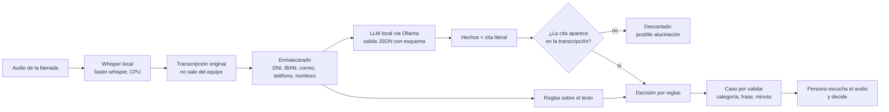

# Auditor local de llamadas con IA

Auditoría de calidad de llamadas de venta con IA que **funciona entera en local**: transcribe el audio, enmascara los
datos personales, pide a un modelo de lenguaje local que extraiga hechos y decide con reglas que **exigen una prueba
literal** para cada aviso. No sanciona: propone casos «por validar» con la frase y el minuto para que una persona
escuche el audio y decida.

> Esta es una versión de demostración. Las llamadas de `ejemplos/` son **ficticias**; la empresa «TelcoDemo» no existe.

## Por qué así

Revisar llamadas a mano solo permite escuchar una pequeña muestra. Un modelo de lenguaje puede leerlas todas, pero tiene
dos problemas en un entorno con datos personales:

1. **Privacidad:** las grabaciones contienen DNI, cuentas bancarias, teléfonos y direcciones dictados en voz alta.
2. **Alucinaciones:** un modelo puede afirmar que el agente dijo algo que nunca dijo, y eso acabaría en una acusación
   injusta.

El diseño ataca los dos: nada sale del equipo y ninguna afirmación del modelo se acepta sin comprobarla contra el texto.

## Arquitectura



| Módulo | Qué hace |
|---|---|
| `auditor/transcribir.py` | Transcribe con faster-whisper en CPU y guarda una copia enmascarada. |
| `auditor/enmascarar.py` | Sustituye documentos, cuentas, correos, números dictados y nombres por etiquetas. |
| `auditor/extraer.py` | Pregunta al LLM local con un esquema JSON fijo y temperatura 0. |
| `auditor/texto.py` | Localiza cada cita en la transcripción (comparación difusa por ventanas) y da su minuto. |
| `auditor/decidir.py` | Reglas: acepta solo hechos con prueba, busca faltas graves también sin el modelo y nunca sanciona. |

## Decisiones de seguridad y privacidad

- **Procesamiento 100 % local.** Whisper y el LLM corren en el equipo; el modelo se consulta en `127.0.0.1`. No hay
  llamadas a APIs externas.
- **Minimización de datos.** Personas y modelo solo leen la copia enmascarada. El LLM recibe el texto sin documentos,
  cuentas ni teléfonos.
- **Sin prueba no hay aviso.** Cada hecho del modelo lleva una cita; si la cita no está en la transcripción (o tiene más
  de 150 palabras, señal de que es un resumen y no una cita) se descarta y queda anotado.
- **Doble vía para lo grave.** Las faltas graves (por ejemplo, tramitar a nombre de una persona ausente) se buscan
  también con reglas sobre el texto, para no depender solo del modelo. Las frases negadas («a nombre de otra persona no
  te da ningún beneficio») no cuentan.
- **El modelo propone, el código decide.** Si el modelo dice que el agente «se rinde» pero hay intentos verificados tras
  el rechazo, prevalecen los hechos verificados.
- **Persona en el circuito.** El resultado es «por validar», nunca una sanción automática.
- **Secretos fuera del código.** En el proyecto real, credenciales y rutas del equipo viven en un fichero local ignorado
  por git, y el repositorio usa un `.gitignore` de lista blanca: solo se sube lo que se nombra explícitamente.

### Modelo de amenazas resumido

| Riesgo | Mitigación |
|---|---|
| Fuga de datos de clientes a terceros | Todo local; sin APIs externas. |
| Exposición de datos al revisar | Revisión solo sobre la copia enmascarada. |
| Acusación falsa por alucinación del modelo | Cita literal obligatoria y verificada; persona valida. |
| Instrucciones copiadas como si fueran la llamada | Las citas deben coincidir con la transcripción, no con el prompt. |
| Datos o secretos en el repositorio | `.gitignore` de lista blanca y revisión antes de cada subida. |

## Probarlo

```bash
python -m unittest discover tests      # pruebas, sin modelo
python demo.py                         # demostración con hechos ya extraídos
python demo.py --ollama                # con un modelo local (ollama pull qwen2.5:7b)
```

Para transcribir audios propios: `pip install -r requirements.txt` y `auditor.transcribir.transcribir(ruta, carpeta)`.

Salida de la demo (fragmento):

```
=== llamada_3_tercero_y_alucinacion.txt ===
  [00:20] Dame su DNI, que es [DOC], y su correo [EMAIL], y lo dejamos hecho.
Estado: por_validar
  AVISO Grave: datos de terceros (00:11, prueba: Regla): «No pasa nada, lo ponemos a nombre de tu marido...»
  nota: promesa: es un precio fijo o promocional, permitido; descartada
  nota: comunicacion_externa: la cita del modelo no aparece en la transcripción; descartada como posible alucinación
```

## Limitaciones

- La grabación es mono: el texto no dice quién habla, así que cada aviso trae la frase para comprobarlo.
- El enmascarado por patrones no es perfecto (nombres sin fórmula de presentación, direcciones); por eso es una capa más,
  no la única.
- El tono (ironía, desgana) no se ve en el texto: esas llamadas hay que escucharlas.
- Las reglas de ejemplo son genéricas; en un uso real se calibran con veredictos de auditores humanos.

## Autor y licencia

Diseñado y desarrollado por **Ashyv15**. © 2026, todos los derechos reservados: el código puede consultarse con fines de
evaluación, pero no copiarse, modificarse ni redistribuirse sin permiso escrito. Ver [LICENSE](LICENSE).

**Contacto y solicitudes de permiso:** a través de mi perfil de GitHub, [github.com/Ashyv15](https://github.com/Ashyv15).
